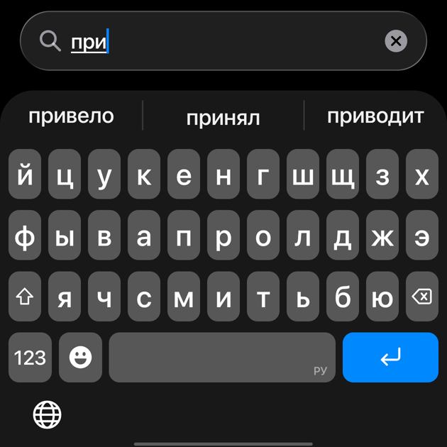
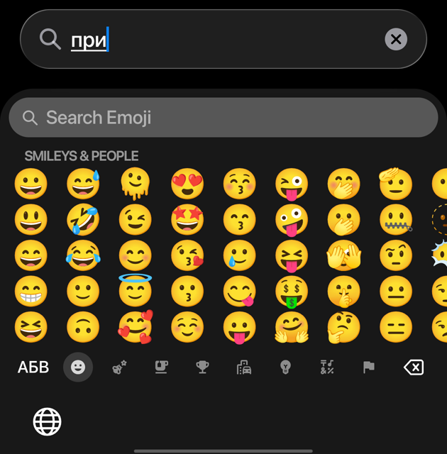
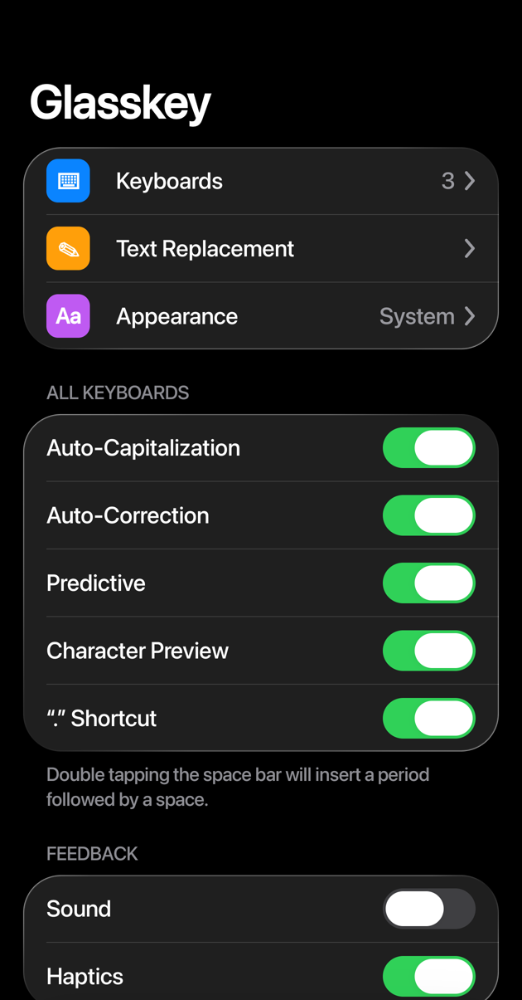

# Glasskey

An Android keyboard that looks and feels like the iOS 27 keyboard. Clean layout, no toolbar, liquid glass.

Built on [HeliBoard](https://github.com/Helium314/HeliBoard), so it stays fully offline: no internet permission, nothing leaves the phone.

<p>
  
  
  
</p>

## Features

- iOS 27 look: key shapes, popups, long-press panel, blurred glass panel (Android 12+)
- Suggestions and autocorrect, with letter-by-letter suggestion animation; the suggestion bar can be hidden
- Globe key under the keys: one tap goes back to the previous language, quick taps cycle through all of them, long press opens the list
- Language badge on the space bar (A, Қ, РУ …)
- Space bar trackpad: hold space and slide to move the cursor
- iOS-style emoji keyboard with search in 74 languages
- Text replacement (shortcut → phrase)
- Fonts: Inter (default), Golos Text, Onest, Noto Sans or the system font
- Settings and setup screens redesigned in the iOS 27 style
- Russian, English and Kazakh out of the box (Kazakh letters on long press); other HeliBoard languages still work

## Install

Download the APK from [Releases](https://github.com/r415uk3/glasskey/releases/latest), open it, then follow the setup screens to enable Glasskey and make it your keyboard.

Requires Android 5.0+. Glass blur needs Android 12+.

## Build

```sh
./gradlew :app:assembleDebugNoMinify
```

The APK ends up in `app/build/outputs/apk/debugNoMinify/`. A release build is signed only when `GLASSKEY_STORE_FILE`, `GLASSKEY_STORE_PASSWORD`, `GLASSKEY_KEY_ALIAS` and `GLASSKEY_KEY_PASSWORD` are set in `~/.gradle/gradle.properties`.

## Credits

- [HeliBoard](https://github.com/Helium314/HeliBoard) and the AOSP / OpenBoard keyboards it is based on
- [Backdrop / AndroidLiquidGlass](https://github.com/Kyant0/AndroidLiquidGlass) for the liquid glass toggles and buttons
- [AndroidHiddenApiBypass](https://github.com/LSPosed/AndroidHiddenApiBypass)
- Emoji names from [Unicode CLDR](https://github.com/unicode-org/cldr-json)
- Fonts: [Inter](https://github.com/rsms/inter), Golos Text, Onest, Noto Sans (SIL OFL 1.1)

The full list with licenses is in the app under Settings → About.

Glasskey was written with the help of AI ([Claude Code](https://claude.com/claude-code)). Please don't report Glasskey issues to HeliBoard.

## License

GPL-3.0-only, same as HeliBoard. See [LICENSE](LICENSE).

iOS is a trademark of Apple Inc. Glasskey is not affiliated with Apple.
